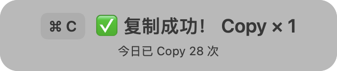
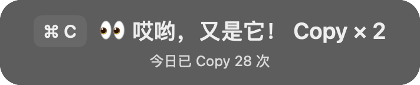

# CopyPop 1.0

原生 SwiftUI + AppKit 菜单栏复制 HUD，适用于 macOS 13 或更新版本，支持 Apple Silicon 和 Intel。

## 界面预览





## 运行与安装

从仓库的 [Releases](../../releases) 下载 `CopyPop-macOS.zip`。

解压 CopyPop-macOS.zip，双击 CopyPop.app。也可以先将它拖到“应用程序”再运行；授权前最好先固定安装位置。应用没有主窗口，入口在菜单栏的剪贴板图标。

本交付使用本地临时签名，未经过 Apple 开发者签名或公证。如果系统拦截，请在确认来源后通过“系统设置 → 隐私与安全性 → 仍要打开”放行。无需关闭系统安全保护。

首次启动不强制申请键盘权限。菜单中选择“启用 ⌘C 检测…”，在“输入监控”中打开 CopyPop；必要时退出再启动。无需辅助功能权限。菜单里的“模式”显示是否成功建立监听。若系统另外询问读取其他应用剪贴板的权限，需要允许后才能检测更新。

## 已实现

- 顶部居中、72px 高，两行圆角毛玻璃 HUD；第一行快捷键 + emoji + 趣味文案 + Copy × N，第二行今日总数。
- 自动适配深浅色，不抢焦点、不拦截鼠标，约 2 秒后完全淡出。
- 同一个窗口更新，不堆叠；第 2 次起左右轻晃约 0.3 秒、最大 7px；尊重系统“减少动态效果”。
- 位置跟随鼠标所在显示器，避开菜单栏；支持全屏空间。
- A → B → A 时 A 继续累计。当天本次运行内累计同内容次数；日期变化或退出后清空内容摘要。
- 今日总数按系统本地日期重置，并可跨重启恢复。
- 暂停、继续、HUD 预览、权限入口、退出均在菜单栏。

## 统计与降级

“复制成功”表示观察到了非空剪贴板更新，并不保证复制来源或内容正确。菜单复制、应用自动写入、通用剪贴板同步也可能计入，此时按键标签显示 Copy；检测到 ⌘C 时显示 ⌘ C。

输入监控获准后，监听仅处理无其他修饰键的 ⌘C，忽略长按自动重复。检测到按键后约 1 秒仍没有剪贴板更新，显示“未确认复制 · 本次未计数”。没有选中内容、应用没有重新写入相同内容、读取被拒绝时都不会凭按键增加次数。未授权时无法知道这种没有更新的按键操作。

剪贴板每 80ms 观察一次，并等待至少 80ms 稳定，减少清空/填充两阶段造成的误报。非常快速的连续更新可能合并，不能保证统计每一次按键。不监听或显示其他快捷键。

## 隐私

不联网、不记录按键日志、不显示剪贴板原文。仅持久保存日期和总数两个字段。

支持文本、文件 URL、PNG、TIFF、RTF、PDF；使用每次启动随机生成的 HMAC-SHA256 密钥计算内存摘要。不同格式即使看起来相同，也可能视为不同内容。原文只在计算期间短暂读取，不写入磁盘。

发现 ConcealedType、TransientType、AutoGeneratedType 标记时不读取内容摘要，仅计总数；无标记的敏感内容无法可靠自动识别。未知格式或超过 8 MB 的内容不做重复识别。为限制内存，超过 10,000 种摘要时清空重复识别表。暂停不会改变剪贴板。

默认无声音、不自动开机启动。

## 构建

安装 Xcode 或兼容的 Apple Swift 工具链后，在此目录执行：

```sh
./build.sh
```

得到 `.build-release/CopyPop.app`。脚本同时编译 arm64、x86_64 并合并为通用应用，完成本地签名验证。

```sh
swift test
```

测试跨内容累计、重启隐私、敏感内容计数与午夜重置。项目可直接用 Xcode 打开 Package.swift。

内置隔离验证（不修改用户剪贴板，使用专用测试剪贴板和临时统计域）：

```sh
mkdir -p /tmp/CopyPopVerification
open -n .build-release/CopyPop.app --args --verify-ui /tmp/CopyPopVerification
```

会输出两张真实原生视图渲染 PNG 和验证 JSON，随后退出。
